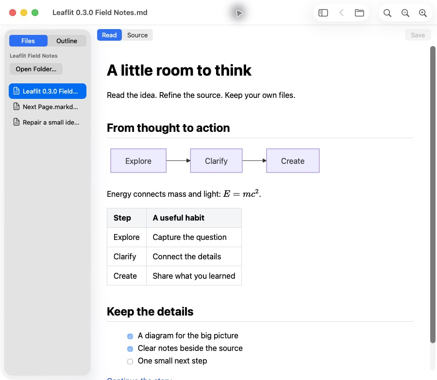
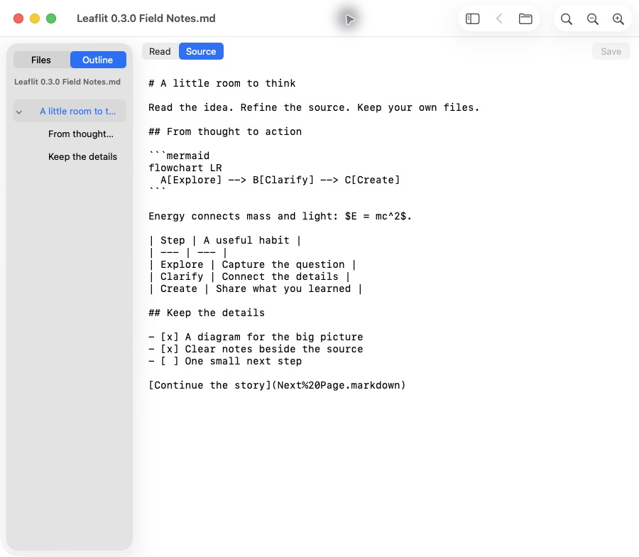

# Leaflit

**Markdown from your terminal. Room to read.**

A read-first Markdown viewer for macOS, built for the plans, specs and notes that come out of LLM terminal workflows. Open a file in a dedicated native window, read rendered tables, Mermaid diagrams and LaTeX math, then return to your terminal. Saved changes appear automatically.

The public **0.3.1 preview** starts in Read and offers native Source editing for small corrections. Preview unsaved changes, then save explicitly. There is no autosave or automatic formatting.

[Website](https://magicsih.github.io/leaflit/), [Download the 0.3.1 preview](https://github.com/magicsih/leaflit/releases/tag/v0.3.1), [Issues](https://github.com/magicsih/leaflit/issues)

## Why Leaflit exists

I built Leaflit because I wanted to open Markdown from an LLM terminal workflow without bringing an IDE and its workspace along just to read a file. Raw terminal output is useful while working, but plans and technical notes are easier to review with rendered headings, tables, diagrams and math.

Leaflit gives that reading step its own window and a command: `leaflit ./plan.md`. It follows saved changes and leaves the file untouched while reading. Switch to Source when generated Markdown needs a small correction, preview it in Read, then save explicitly. The aim is a small, direct reading workflow; measured resource use and its limits are documented below.

## See it in use

```sh
leaflit ./plan.md
```



Actual signed 0.3.0 distribution on macOS, with an explicitly chosen folder in Files. The terminal command opens a normal window like this; there is no editor setup or workspace to configure.

Built with Swift, AppKit and WKWebView for Apple Silicon. The deployment target is macOS 14 or later; runtime verification so far covers Apple M3 on macOS 26.6.2. Earlier macOS releases and Intel Macs have not been verified.

## Install

Download the [0.3.1 preview](https://github.com/magicsih/leaflit/releases/tag/v0.3.1), extract the ZIP and move Leaflit.app to Applications. The public app is signed and notarized. Homebrew installs the app and launcher together:

```sh
brew install --cask magicsih/tap/leaflit
leaflit "path/to/document.md"
# Upgrade an existing Homebrew installation:
brew update
brew upgrade --cask magicsih/tap/leaflit
```

The launcher does not change Finder's default application. The [public distribution checks](docs/releases/0.3.1-verification.md) cover the downloaded app and Homebrew installation. See the [release procedure](docs/releasing.md) for signing, publication and artifact verification.

## Work in chda. Read in Leaflit.

[chda](https://magicsih.github.io/chda/) is a terminal with a git worktree sidebar and live coding-agent status. Use it to keep each task and agent in its own worktree, then open a plan or spec in Leaflit from a shell in that worktree:

```sh
leaflit ./plan.md
```

Keep the document beside your terminal while the agent works. Leaflit follows saved changes and provides Find, Outline, Mermaid diagrams and LaTeX math in a separate reading window. If generated Markdown needs a small correction, switch to Source and save explicitly.

chda also has a built-in local browser preview for quick Markdown checks. Leaflit is an optional companion for Apple Silicon Macs running macOS 14 or later, and works with any terminal. See [chda's workflow and installation](https://magicsih.github.io/chda/#leaflit) or its [source repository](https://github.com/magicsih/chda).

## Read

- Open `.md`, `.markdown` and `.mdown` files from Finder, the Open menu, drag and drop, or the `leaflit` launcher.
- Read tables, strikethrough, disabled task lists, code blocks, local PNG/JPEG images, Mermaid diagrams and KaTeX math.
- Keep leading YAML metadata out of Read and Outline while retaining it in Source.
- Search, copy, zoom, follow heading anchors and navigate between relative Markdown links with Back.
- Browse an explicitly chosen folder with Files, or switch to Outline to jump between headings. Collapse the sidebar for more reading space.
- Use separate windows for separate files. Opening the same file again activates its existing window.
- Follow saved changes, including atomic file replacement, while preserving the current reading position.
- Use the system light or dark appearance. No account, server or analytics service is required.

Math delimiters are `$…$`, `$$…$$`, `\(…\)` and `\[…\]`. Diagram and formula errors preserve the original source with a short message. Long code blocks and tables scroll horizontally.

Raw HTML is shown as text. Remote resources, document scripts, unsafe URL schemes and Mermaid configuration directives are blocked. External web links open in the default browser only after a user click. Reading, refreshing and switching modes never write a document. Only explicit Save or Save a Copy writes files.

| Action | Shortcut |
| --- | --- |
| Open | ⌘O |
| Open folder | ⇧⌘O |
| Toggle sidebar | ⌃⌘S |
| Find | ⌘F |
| Next / previous match | ⌘G / ⇧⌘G |
| Back | ⌘[ |
| Copy selection | ⌘C |
| Read / Source | ⌥⌘1 / ⌥⌘2 |
| Save / Save a Copy | ⌘S / ⇧⌘S |
| Zoom in / out / reset | ⌘+ / ⌘− / ⌘0 |

## Correct generated Markdown in Source

Read remains the default. Source is a native plain-text Markdown editor for quick corrections, including malformed diagrams and formulas. It is created only when first opened. There is no autosave, automatic formatting or rich-text Write mode.



Actual signed 0.3.0 distribution, captured from the same verified ZIP as the Read screen. The [Source editing verification report](docs/qa/source-editing-0.3.0.md) records the reviewed candidate, three UI rounds, resource measurements and remaining limitations.

- Switch to Source with ⌥⌘2 and back to Read with ⌥⌘1. Read previews unsaved changes.
- Use **Edit Source** on a diagram or formula error to reach its original source block.
- Save explicitly with ⌘S in either mode, or use **Save a Copy…** with ⇧⌘S. Native Undo, Redo and Find work in Source.
- External changes keep a dirty draft intact. Reload requires an explicit discard; Save a Copy creates a new file without overwriting the changed original.
- Navigation, window close and quit offer Save, Cancel or Discard when changes are pending. A failed save retains the draft and cancels the pending action.
- Choosing an Outline heading from Source returns to Read at that heading.

Original UTF-8 BOM and existing line endings are retained. Coordinated saves compare file identity and bytes before atomic replacement; this is not a filesystem-wide compare-and-swap guarantee against an unrelated writer racing during replacement. See the [saving design](docs/design/source-editing/design.md).

## Build locally

The public app includes the Leaf Page icon and optional Files/Outline sidebar. The [branding source](assets/branding/README.md) preserves the selected icon. Website source and publishing instructions are in [site/README.md](site/README.md).

Verified with Xcode 27, Node.js 24 and npm 11. Dependencies are pinned in `package-lock.json`. Ruby is needed only when regenerating the Xcode project, not for a normal build.

Source builds produce 0.3.1. The public preview adds Developer ID signing and notarization to that verified product.
The [0.3.0 verification report](docs/qa/source-editing-0.3.0.md) records explicit editing and its verification. The historical [0.2.1 report](docs/qa/product-followups-0.2.1.md) retains sidebar fixes, document-switching improvements and its separate measurements.

```sh
./scripts/build.sh
open build/Leaflit-0.3.1/Leaflit.app
./build/Leaflit-0.3.1/leaflit Fixtures/Welcome.md
open -a "$PWD/build/Leaflit-0.3.1/Leaflit.app" "Fixtures/Next Page.markdown"
```

For Xcode, build the web assets first, then run the Leaflit scheme:

```sh
npm ci --ignore-scripts
npm run build
open Leaflit.xcodeproj
```

The local candidate folder contains the app and launcher. Keep them together when moving the folder. Local builds use ad-hoc signing. They are distinct from a Developer ID signed and notarized public release. Building locally does not change PATH or Finder's default application.

## Verify

```sh
./scripts/verify.sh Release
# Run performance measurements separately from other app reviews.
python3 scripts/benchmark.py
python3 scripts/measure-resources.py
python3 scripts/measure-memory-cases.py
# Run only the platform-independent document module or web parser tests.
swift test
npm test
```

The local 0.3.0 comparison measured total footprint medians of 130.6MiB in Read and 145.0MiB in Source after Read, using the same 100KiB math/Mermaid document, three fresh runs per mode and CUA observation. These include the app and its WebKit helpers. They describe whole states, not an isolated editor allocation cost; the 60MiB comparison target remains unmet. See the [Source verification report](docs/qa/source-editing-0.3.0.md) for ranges, all samples and the corrected timing protocol.

The original 0.1.0 [implementation design](docs/design/0.1.0/design.md), [test plan](docs/design/0.1.0/test-plan.json), [QA report](docs/qa/report.md) and [memory measurements](docs/qa/memory-analysis.md) remain historical evidence. Separate 0.2.0 and 0.2.1 measurements are preserved in the [sidebar report](docs/qa/sidebar-report.md) and [product follow-up report](docs/qa/product-followups-0.2.1.md). Their observer conditions differ; do not pool them with this Source comparison.

Rich-text Write, printing, PDF export, syntax highlighting, Obsidian-specific syntax and automatic updates remain deferred. Outline provides heading navigation. An inactive public-download capture had an [initial blank Read body](https://github.com/magicsih/leaflit/issues/29) that recovered after Source-to-Read; the cause is unconfirmed. Rendered math currently has a [plain-text clipboard fidelity limitation](https://github.com/magicsih/leaflit/issues/26). Ordinary Source dark appearance remains [unverified](https://github.com/magicsih/leaflit/issues/27). Spoken VoiceOver navigation and earlier macOS runtime coverage remain incomplete. Follow-up work is tracked in [GitHub issues](https://github.com/magicsih/leaflit/issues).

Regenerate the project only when its structure changes, using `ruby scripts/generate-project.rb` with xcodeproj 1.27.0. The generated Xcode project and scheme are checked in.

## License

MIT. Bundled renderer dependency licenses are included in `THIRD-PARTY-NOTICES.txt` inside the app.
