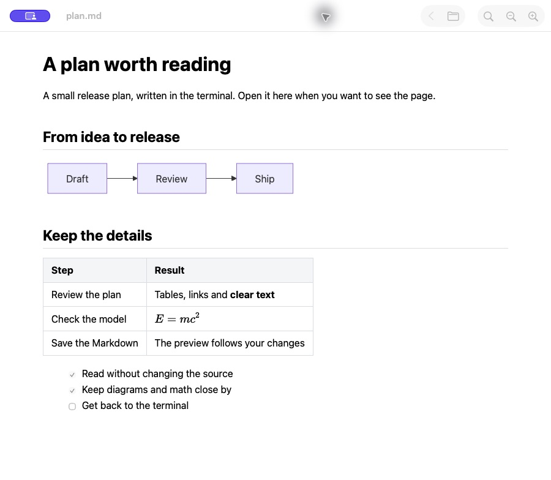

# Leaflit

**Markdown from your terminal. Room to read.**

A read-only Markdown viewer for macOS, built for the plans, specs and notes that come out of LLM terminal workflows. Open a file in a dedicated native window, read rendered tables, Mermaid diagrams and LaTeX math, then return to your terminal. Saved changes appear automatically.

[Website](https://magicsih.github.io/leaflit/), [Download the 0.1.0 preview](https://github.com/magicsih/leaflit/releases/tag/v0.1.0), [Issues](https://github.com/magicsih/leaflit/issues)

## Why Leaflit exists

I built Leaflit because I wanted to open Markdown from an LLM terminal workflow without bringing an IDE and its workspace along just to read a file. Raw terminal output is useful while working, but plans and technical notes are easier to review with rendered headings, tables, diagrams and math.

Leaflit gives that reading step its own window and a command: `leaflit ./plan.md`. It stays read-only, follows saves and leaves the source file untouched. The aim is a small, direct reading workflow; measured resource use and its limits are documented below.

## See it in use

```sh
leaflit ./plan.md
```



Actual public 0.1.0 app on macOS. The terminal command opens a normal window like this; there is no editor setup or workspace to configure. The icon at the top of this README is the selected new artwork for local 0.2.0 builds; the published 0.1.0 app retains its original icon.

Built with Swift, AppKit and WKWebView for Apple Silicon. The deployment target is macOS 14 or later; runtime verification so far covers Apple M3 on macOS 26.6.2. Earlier macOS releases and Intel Macs have not been verified.

## Install

Download the [0.1.0 preview](https://github.com/magicsih/leaflit/releases/tag/v0.1.0), extract the ZIP and move Leaflit.app to Applications. The public app is signed and notarized. Homebrew installs the app and launcher together:

```sh
brew install --cask magicsih/tap/leaflit
leaflit "path/to/document.md"
```

The launcher does not change Finder's default application. The [public distribution checks](docs/releases/0.1.0-verification.md) cover the downloaded app and Homebrew installation. See the [release procedure](docs/releasing.md) for signing, publication and artifact verification.

## Read

- Open `.md`, `.markdown` and `.mdown` files from Finder, the Open menu, drag and drop, or the `leaflit` launcher.
- Read tables, strikethrough, disabled task lists, code blocks, local PNG/JPEG images, Mermaid diagrams and KaTeX math.
- Search, copy, zoom, follow heading anchors and navigate between relative Markdown links with Back.
- Use separate windows for separate files. Opening the same file again activates its existing window.
- Follow saved changes, including atomic file replacement, while preserving the current reading position.
- Use the system light or dark appearance. No account, server or analytics service is required.

Math delimiters are `$…$`, `$$…$$`, `\(…\)` and `\[…\]`. Diagram and formula errors preserve the original source with a short message. Long code blocks and tables scroll horizontally.

Raw HTML is shown as text. Remote resources, document scripts, unsafe URL schemes and Mermaid configuration directives are blocked. External web links open in the default browser only after a user click. The app never edits its source documents.

| Action | Shortcut |
| --- | --- |
| Open | ⌘O |
| Find | ⌘F |
| Next / previous match | ⌘G / ⇧⌘G |
| Back | ⌘[ |
| Copy selection | ⌘C |
| Zoom in / out / reset | ⌘+ / ⌘− / ⌘0 |

## Build locally

Local 0.2.0 builds add a collapsible native sidebar with `Files` and `Outline` modes. Use `Open Folder…` (Shift-Command-O) to browse a folder, or switch to `Outline` to navigate the current document's headings. Toggle the sidebar with Control-Command-S. The published GitHub and Homebrew release remains the 0.1.0 preview until a new release is authorized. See the [sidebar design](docs/design/navigation-sidebar/design.md) and [verification status](docs/qa/sidebar-report.md).


The Files/Outline screenshot shows the local 0.2.0 candidate, not the current public download. The selected icon is documented in the [branding source](assets/branding/README.md). Website source and publishing instructions are in [site/README.md](site/README.md).

Verified with Xcode 27, Node.js 24 and npm 11. Dependencies are pinned in `package-lock.json`. Ruby is needed only when regenerating the Xcode project, not for a normal build.

```sh
./scripts/build.sh
open build/Leaflit-0.2.0/Leaflit.app
./build/Leaflit-0.2.0/leaflit Fixtures/Welcome.md
open -a "$PWD/build/Leaflit-0.2.0/Leaflit.app" "Fixtures/Next Page.markdown"
```

For Xcode, build the web assets first, then run the Leaflit scheme:

```sh
npm ci --ignore-scripts
npm run build
open Leaflit.xcodeproj
```

The local candidate folder contains the app and launcher. Keep them together when moving the folder. Local builds use ad-hoc signing. They are distinct from a Developer ID signed and notarized public release. Building locally does not change PATH or Finder's default application.

## Verify

```sh
./scripts/verify.sh
# Run performance measurements separately from other app reviews.
python3 scripts/benchmark.py
python3 scripts/measure-resources.py
python3 scripts/measure-memory-cases.py
# Run only the platform-independent document module or web parser tests.
swift test
npm test
```

See the original 0.1.0 [implementation design](docs/design/0.1.0/design.md), [test plan](docs/design/0.1.0/test-plan.json), [QA report](docs/qa/report.md) and [memory measurements](docs/qa/memory-analysis.md). Those historical measurements include the app and WebKit helpers: median footprint was 69.7MiB for a 1KiB document and 85.6–131.1MiB across the measured 100KiB document structures. Some runs used more memory; the reports preserve the full ranges. The initial 60MiB comparison target was not met. Current 0.2.0 verification and its separate matched comparison are tracked in the [sidebar report](docs/qa/sidebar-report.md).

Editing, a table of contents, printing, PDF export, syntax highlighting, Obsidian-specific syntax and automatic updates are outside version 0.1.0. Spoken VoiceOver navigation and earlier macOS runtime coverage remain incomplete. Follow-up work is tracked in [GitHub issues](https://github.com/magicsih/leaflit/issues).

Regenerate the project only when its structure changes, using `ruby scripts/generate-project.rb` with xcodeproj 1.27.0. The generated Xcode project and scheme are checked in.

## License

MIT. Bundled renderer dependency licenses are included in `THIRD-PARTY-NOTICES.txt` inside the app.
