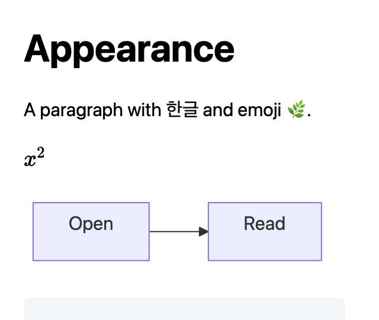
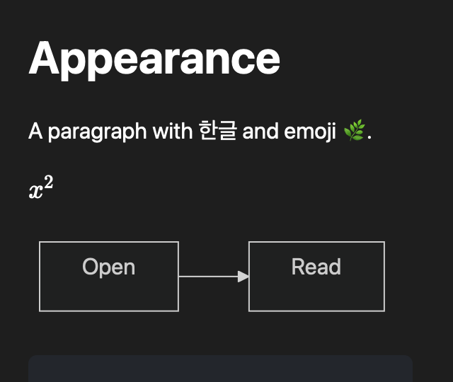

# Leaflit 0.1.0 로컬 후보 검수

2026-10-18에 Apple M3와 macOS 26.6.2에서 실행했다. 최소 지원 대상은 macOS 14이며 이전 OS 실행은 미확인이다. 제품 코드 후보는 `dffa027d7aa566b915ea0a0fe59a80af73922e01`이다. 최종 문서 및 테스트 커밋 뒤 제품 소스가 같은지 확인하고 테스트와 Release 빌드를 다시 실행해 `build/verification.json`, `build/Leaflit-0.1.0/build-info.json`에 그 커밋을 기록한다.

## 구현

Swift와 AppKit, WKWebView 앱, Foundation 문서 모듈과 테스트 대상을 추가했다. macOS 파일 열기, 문서별 창, 상대 링크와 Back, 검색, 복사, 확대, 제목 앵커, 파일 변경 감시와 오류 복구를 제공한다. markdown-it, Mermaid와 KaTeX, 글꼴은 버전 고정 후 앱에 포함하며 수식과 다이어그램만 지연 로딩한다.

원문 HTML은 텍스트로 표시한다. CSP와 WebKit 규칙으로 원격 요청을 막고, 로컬 이미지는 원문에서 참조한 PNG와 JPEG만 파일 형식을 확인해 제공한다. 앱은 문서를 쓰지 않으며 서버, 원격 분석과 전체 디스크 접근 요구를 넣지 않았다. 로컬 임시 서명만 사용하고 App Sandbox, Developer ID와 공증은 적용하지 않았다. Finder 기본 연결과 PATH를 변경하지 않았다.

## 자동 검증

구현자와 다른 검수자가 위 후보에서 `./scripts/verify.sh Release`를 실행했다. 로그는 `build/verify-independent.log`, 테스트와 스크린샷 원본은 `build/DerivedData/Logs/Test`의 xcresult다.

| 확인 | 결과 |
| --- | --- |
| 웹 문법 테스트 | 4개 통과 |
| Foundation 모듈 테스트 | 6개 통과 |
| 실제 WKWebView를 사용하는 Xcode 테스트 | 18개 통과 |
| 배포 의존성 취약점 조회 | npm audit 보고 0건 |
| 원문 불변 | 읽기 전후 데이터 비교 통과, 독립 UI 검수에서 fixture SHA-256 비교 |
| 큰 문서 | 약 1MiB와 5MiB 본문 표시 및 원문 불변 통과 |

통합 실행은 네 가지 수식 구분자, Mermaid 노드 라벨과 접근성 이름, 잘못된 문법, HTML과 위험한 링크, 상대 문서 및 제목 이동, 실제 메뉴 명령 경로, 원자적 저장과 연속 저장, 오래된 결과 폐기, 삭제와 복구, 로컬 이미지, 스크롤 복원과 렌더링 중 사용자 이동, 같은 내용 저장과 주변 파일 변경 뒤 링크, 확대와 외관, 원격 fetch 차단을 포함한다.

테스트 앱은 WebKit의 화면 가림 중 animationFrame 정지를 피하도록 테스트 창만 다른 창 위에 놓았다. 제품 창에는 이 설정이 없다. Release 구성 통합 테스트에는 내부 상태 검증을 위한 ENABLE_TESTABILITY=YES를 사용하며 배포 후보는 일반 Release 설정으로 별도 clean build한다.

## 독립 화면 검수

[1회차](ui-round1.md), [2회차](ui-round2.md), [3회차 계획](ui-round3-plan.md)과 [3회차 결과](ui-round3.md)를 각각 기록한다. 회차별 후보와 실행 범위가 다르므로 앞선 실패를 최종 통과로 간주하지 않는다.

1회차에서 Mermaid 라벨, Back 메뉴와 검색 필드 붙여넣기 문제를 찾았다. 2회차에서 라벨과 붙여넣기 회복을 확인하고 Back 메뉴와 수식 오류 영역의 테두리 문제를 남겼다. 이후 실제 표시 번호와 읽기 요청 번호를 나누고, 배경 창의 메뉴 대상을 보이는 창 순서로 찾도록 고쳤다. 수식 오류 영역과 다이어그램의 접근성 이름도 보완했다.

3회차에서 일반 저장과 파일 교체, 20회 연속 갱신, 같은 내용 저장과 주변 파일 변경 뒤 링크, 삭제 및 잘못된 UTF-8 복구, 오류 테두리, 다이어그램 노드 이름과 Finder Open With를 실제로 확인했다. 원문 fixture 네 개의 SHA-256은 전후 동일했다.

메뉴와 ⌘F는 처음 CUA 연결에서 실패로 관찰됐으나 동일한 배포 바이너리에 새로 연결한 한 차례의 한정 확인에서는 Back 메뉴 복귀와 검색 행 및 포커스가 정상 동작했다. 그 사이 CUA가 `originalApplicationActivationFailed`를 반환했다. 초기 관찰은 삭제하지 않고 도구 연결 및 활성화 상태에 따른 관찰 불일치로 보존한다. 별도로 실제 NSMenu의 활성 상태와 확대, Back, ⌘F 명령 전달을 확인하는 자동 테스트도 추가했다. 최종 전체 재실행 기록은 `build/verify-final.log`와 `build/verification.json`에 둔다.

VoiceOver는 켜기와 시작 대화상자, 실행 프로세스를 확인했고 종료 후 원래 off 상태로 복원했다. 도구에서 실제 음성과 VoiceOver 커서 이동을 확인할 수 없어 음성 탐색은 미확인이다. Finder에서 다른 앱으로 여는 흐름은 통과했으며 기본 연결은 변경하지 않았다. 교차 앱 좌표를 확인할 근거가 부족해 실제 Finder 드롭은 미실행으로 남겼다.

아래는 실제 WKWebView에서 캡처한 640pt 창, 200% 확대 화면이다.

## 성능과 자원

독립 측정 결과를 아래에 기록한다. 첫 표시 수치는 DOM 교체 뒤 두 animationFrame을 기다린 표시 이벤트를 기준으로 한 근사값이며, 실제 픽셀의 표시 시점을 하드웨어로 측정한 값은 아니다. 운영체제의 파일 캐시는 비우지 않는다.

- 고정 입력: `Fixtures/Benchmark100KiB.md`, 102400바이트, 한글과 이모지, 수식과 Mermaid 포함.
- 새 앱 열기: `python3 scripts/benchmark.py`, 매회 앱 프로세스를 새로 시작하고 open 명령 요청부터 표시 이벤트의 시각까지 20회 측정.
- 문서 전환: 같은 고정 문서를 두 파일로 복사해 실행 중인 ReaderController에서 20회 전환.
- 자원: `python3 scripts/measure-resources.py`, 앱 실행 전후 PID를 비교해 새 WebKit 보조 프로세스를 포함하고 footprint 및 60초 유휴 CPU를 측정.
- 백분위: 20개 값을 정렬한 뒤 가까운 순위 방식의 95백분위인 19번째 값을 사용한다.

[전체 표본과 측정값](measurements.json)을 보존한다.

| 표시 시간 | 중앙값 | 95백분위 |
| --- | ---: | ---: |
| 새 앱, 본문 | 1169.9ms | 1288.9ms |
| 새 앱, 수식과 다이어그램 완료 | 1508.2ms | 1622.7ms |
| 문서 전환, 본문 | 115.0ms | 121.5ms |
| 문서 전환, 수식과 다이어그램 완료 | 172.3ms | 192.7ms |

앱과 WebKit의 footprint 총계는 **148.5MiB**였고 안정 상태 RSS 합계는 142.4MiB였다. 두 지표를 같은 값으로 취급하지 않는다. 유휴 CPU는 60회 표본, 실제 70.34초 동안 합산 평균 0.14%였다. 앱 설치 크기는 `du` 기준 5.5MiB, 파일 논리 크기 합계는 5.02MiB다. 변경 저장부터 본문 표시까지 한 번의 실행에서 252.3ms를 관찰했다. 일반화할 수 있는 백분위 결과는 아니다.

약 1MiB 문서는 본문 880.7ms와 전체 909.6ms, 약 5MiB 문서는 본문 3074.3ms와 전체 3107.4ms였다. 실제 입력 크기는 각각 1048573바이트와 5242873바이트다. 본문을 생략하지 않고 표시했고 읽기 전후 파일 데이터가 같았다.

초기 비교 목표인 새 앱 첫 표시 500ms, 전환 100ms와 메모리 60MiB에는 미달했다. 설치 크기 20MiB와 유휴 CPU 1% 목표에는 들어왔다. 변경 반영 300ms는 이번 단일 표본에서만 들어왔으므로 지속적인 충족을 주장하지 않는다. 이 수치는 로컬 후보의 관찰 결과이며 성능 우위를 의미하지 않는다.

## 배포 상태와 제한

결과물은 `build/Leaflit-0.1.0/Leaflit.app`, 함께 제공하는 `leaflit` 실행 도구와 `build-info.json`이다. 이 작업은 로컬 후보까지이며 원격 저장소 생성, push, 공개 배포, Developer ID 서명과 공증을 수행하지 않는다.

이전 macOS 버전, Intel Mac과 공개 배포 환경의 실행은 미확인이다. OS 전체 네트워크를 끄지는 않았으며 앱 렌더러의 원격 요청이 차단된 상태에서 표시와 외부 요청 실패를 검증했다. 실제 Finder 드롭, 기본 브라우저에서 웹 링크를 여는 흐름과 VoiceOver 음성 탐색은 미확인이다. 전체 키보드 메뉴 탐색과 도구가 재현하지 못한 단축키의 제한은 3회차 보고서에 기록했다.
