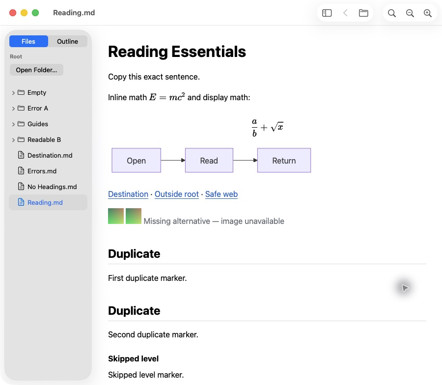
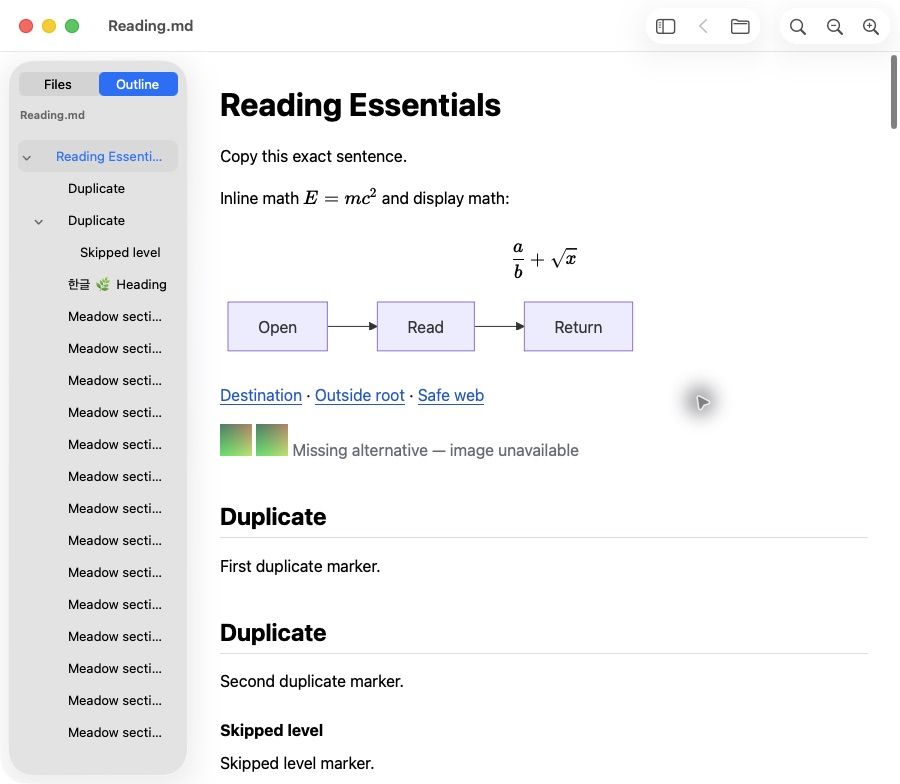

# Files and Outline sidebar verification

## Current state

The local 0.2.0 candidate implements the owner-approved [sidebar design](../design/navigation-sidebar/design.md). Two rendered reviews found defects, and their failed outcomes remain below. Independent verification and a normal Release build passed at `eebc948`. The third rendered review observed the corrected behavior and no new product defect in its executed scenarios. The matched memory set, 20 fresh-process opens and expanded-Files idle CPU sample are complete. Coverage limits and a width-persistence risk remain explicit; this report does not declare every item of the L3 plan passed. Final-commit handoff records are required separately below.

The endpoint is a verified local Release candidate. The published GitHub and Homebrew preview remains 0.1.0. No 0.2.0 distribution signing, notarization, publication, installation or downloaded-artifact verification has been performed.

## Product behavior

One native sidebar uses a fixed top `Files` and `Outline` control alongside the existing single WKWebView. Files starts without a root and browses only an explicitly selected folder. Directory children load on expansion; hidden entries, unsupported files and symbolic links are excluded. Selecting Markdown navigates in the current window with Back, while an already-open canonical document activates its existing window.

Outline labels and identities come from the existing Markdown parse. Native groups follow heading levels, duplicate and Unicode anchors target the rendered IDs, and scrolling updates the selected section. Switching modes preserves the reader, Find query and list state. Visibility, width and mode are remembered; narrow windows collapse the sidebar without replacing the user's visibility preference.

The app remains read-only. Folder-scoped navigation validates the selected file again after asynchronous position capture and before reading through its opened file descriptor. Intentional relative document links may leave the chosen folder while keeping its root unchanged. Renderer events retain document revisions and the existing local-resource and remote-request boundaries.

Actual round 3 captures of the normal Release app, with reviewer-owned fixtures:

## Environment and artifact identity

- Runtime: Apple M3, macOS 26.6.2, build 25G83; Xcode 27.0, build 27A266a.
- Deployment target: macOS 14, Apple Silicon. Earlier macOS and Intel execution are not verified.
- Normal Release app: `build/Leaflit-0.2.0/Leaflit.app`, with adjacent `leaflit` launcher and `build-info.json`.
- Product candidate: `eebc9489216d3ed46e26c2a1850d196d0db3d5ff`.
- Executable SHA-256: `5688e944bab1950fb0f01e6b3b93bde1ec4d71dcb02584cee3d8a60a3c6a2333`.
- Signing state: local ad-hoc build, without Developer ID or notarization.

Later documentation and measurement-tool commits must be distinguished from changes to this running artifact. Preserve the public 0.1.0 output, installed app and existing user windows.

## Independent automated verification

An executor other than the implementer ran `./scripts/verify.sh Release` and then `./scripts/build.sh Release`. The Release integration suite uses `ENABLE_TESTABILITY=YES`; the local app is a separate ordinary clean Release build.

| Check | Result at eebc948 |
| --- | --- |
| JavaScript parser and frame-progress tests | 8 passed |
| Standalone Foundation module | 8 passed |
| Packaging tests | 7 passed |
| Xcode Release suite | 34 passed: 26 Reader tests and the same 8 core tests |
| Production dependency audit | No vulnerabilities reported |
| Normal Release build | Passed |

Do not count the repeated core tests as unique additional coverage. Integration includes real WKWebView rendering, all math delimiters, Mermaid, hostile HTML and links, blocked fetch, local images, Unicode and spaces, replacement saves, obsolete results, source immutability, Back, menu dispatch, visibility, narrow layout and 1MiB/5MiB bodies. New regressions cover outline identity, Files updates, permission-error retention, collapsed re-expansion, delayed path replacement, delayed duplicate-window activation, expanded-tree quiescence, paused-animation progress, initial-wait scrolling, actual pane shrink with both native mode buttons in bounds, and simultaneous Find/recovery at 480pt. Diagnostics observed a 180pt pane with two 79pt segments and a 480pt reader with 338pt fitting minimum.

Evidence is retained under ignored `build/sidebar-verification/`: `verify-eebc948.log`, `build-eebc948.log` and `result-eebc948.json`. The xcresult path is recorded in the result. Raw logs and generated build output are not committed.

The Copilot review request on [PR #11](https://github.com/magicsih/leaflit/pull/11) returned a quota-limit response against `ca4d833`; it supplied no code review. The independent execution and rendered-review evidence above are separate from that unavailable service. No Copilot approval is claimed.

## Failed candidates and corrections

Earlier failures remain separate from later passes:

- `f1f097c`: two native compile errors; no Release or UI pass.
- `9a959f5`: normal scoped reads were rejected because Foundation canonical paths used `/var` while the kernel file-descriptor path used `/private/var`. The anchor test also expected zero offset despite the existing 24pt scroll margin. The path comparison was normalized and the expectation corrected.
- `1b63b11`: automated verification passed, but [actual UI round 1](sidebar-ui-round1.md) failed. Restoring an expanded Files tree started another refresh, repeatedly replacing rows and blocking reliable selection.
- `1da6920`: the new regression failed independently. Expansion events increased from 275 after 250ms to 577 after another 300ms without filesystem changes.
- `8746180`: programmatic expansion restoration no longer starts another refresh. Full automation, including the new quiescence regression, passed. Actual corrected UI behavior must be recorded in the later review results.
- [Round 2](sidebar-ui-round2.md) confirmed expanded navigation and recovery without the workaround, but found clipped mode labels after divider shrink, a 550pt minimum with Find and recovery visible, and prolonged raw math/diagram placeholders with an empty Outline after a live appearance change. A later document mutation recovered rendering; the precise OS trigger remains unproven.
- `78eb9cd`: controlled paused-animation rendering and the 550pt layout failed. Its initial segment assertion inspected a group rather than the two radio buttons, so that assertion was not valid clipping evidence.
- `a5d2cb9`: corrected native accessibility traversal proved a 130pt overflow by the second mode button after shrinking the control.
- `5e5860d`: automation passed, but the executor noticed that explicit segment sizes prevented the pane from actually shrinking. The normal build was held. Stronger tests at `6d0d84f` failed on an actual 311pt pane and on completion resetting an intervening scroll to zero.
- `eebc948`: a mode control with no intrinsic horizontal width leaves sizing to the split view; explicit segment geometry is recomputed within it. Search and recovery text can shrink/wrap at 480pt. Rendering and outline updates use one-shot fallback timers when animation callbacks pause, retain timing provenance, cancel losing callbacks and preserve movement during the initial wait. Independent full verification and the normal Release build passed. Actual round 3 confirmed both mode buttons after divider shrink, Find and recovery at 480pt, and rendered math, Mermaid and Outline progress across appearance changes and background exposure.

## Rendered reviews and resources

[Round 1](sidebar-ui-round1.md) records the failure, bounded workaround, observed passes and omissions. [Round 2](sidebar-ui-round2.md) confirms the expanded-tree correction and records its three additional failures. Keyboard selection, shortcuts and actual copy/paste passed; VoiceOver startup was confirmed, but speech/cursor navigation remained unverified and the original off state was restored. The [third review plan](sidebar-ui-round3-plan.md) covers all three corrections, integrated regression and large navigation lists.

[Round 3](sidebar-ui-round3.md) completed on the handed-off `eebc948` Release app without observing a product defect in the executed paths. It exercised nested Files navigation, Unicode/space paths, copy and Find, additions/removals, retained directory errors and recovery, rapid and replacement saves, 1,000 root files with 100 folders, and a 2,000-heading Outline. Native Open, launcher, `open -a`, duplicate activation, 640pt at 200% zoom and actual scroll tracking were observed. The reviewer restored Auto appearance, Automatic scrollbars and VoiceOver off, closed only its owned app, and confirmed that the two pre-existing user apps survived. Finder Open With and spoken VoiceOver were attempted but unverified; cross-app drag remained unexecuted. These are coverage limits, not inferred passes.

The [matched resource protocol](sidebar-measurement-protocol.md) compares the public baseline with hidden, Files and Outline states on identical fixtures. Its 36 fresh processes, three footprint captures per run, UI readiness gates and helper ownership checks are separate from the three rendered review rounds. Twelve additional public 0.1.0 control processes used the same accessibility observation as the new runs: the original baseline had no such observation, which could affect accessibility-cache allocations. The observation-matched controls are the primary comparison; the retained original baseline remains contextual evidence. Both full sets are complete with unambiguous helper attribution. The [resource report](sidebar-resources.md) and [complete samples](sidebar-resources.json) retain their separate protocols and results.

The first observation-matched control attempt completed one empty run, then stopped when the 0.1.0 plain-1KiB process supplied no complete pair of display events within 30 seconds. Its cause is unconfirmed. Preserve the failed dataset at `build/sidebar-measurements/observed-control-eebc948-20261019-0822`; do not mix its one complete run into the replacement full set. The revised procedure allows actual UI readiness observation immediately after establishing the owned process, collects launch events asynchronously, and keeps missing latency separate from a memory measurement whose visible readiness was confirmed. Apply that procedure to both versions.

The replacement control completed all 12 fresh runs with unambiguous helper attribution; all nine nonempty runs eventually retained both display events. Candidate measurement preparation observed that divider position 230 yields a 222pt pane on this host, while position 238 yields the desired 230pt pane. The harness therefore records the requested divider position separately from the measured width. This also exposed a source-level width-persistence round-trip risk: stored pane width is later used as divider position. Repeated-window drift remains unverified and is tracked in [#13](https://github.com/magicsih/leaflit/issues/13); no fixed 8pt product correction or additional rendered review was performed.

The first candidate measurement attempt at `build/sidebar-measurements/candidate-eebc948-20261019-0836` was also excluded in full. A reused CUA helper still referenced the public app, so its captured empty window did not match the next candidate's nonempty document. One completed empty sample is not valid target-observation evidence and must not enter the replacement 36-run set. The helper now takes the current exact app explicitly; readiness must verify its unique live executable PID and the candidate-only Toggle Sidebar control. This was an observation-tool failure, not an observed app-rendering failure.

The replacement candidate set at `build/sidebar-measurements/candidate-explicit-target-eebc948-20261019-0840` completed all 36 runs. All 27 nonempty runs retained both display phases, and nine empty runs are N/A. The original user apps, candidate executable and fixed fixture hashes were preserved. An independent data audit checked all 144 raw footprint captures, unique case coverage, readiness-evidence hashes and per-run median calculations; its record is `build/sidebar-verification/resource-data-audit.json`.

Across the three sidebar cohorts, app-plus-owned-WebKit median footprint was 70.4–71.8MiB for 1KiB prose, 84.6–87.0MiB for 100KiB prose and 151.3–161.9MiB for the heading-heavy 100KiB benchmark. The observation-matched public control medians were 66.5, 87.3 and 121.8MiB respectively. The benchmark control ranged from 120.5 to 155.5MiB, overlapping the new cohorts; this small whole-app comparison does not isolate sidebar or optional-renderer allocation costs. The initial 60MiB document-reading comparison target was not met.

The separate 20 fresh-process benchmark opens retained 19 animation-frame samples and one timer-fallback sample for each phase. Frame-group median wall-clock time from launch was 721.3ms to body and 915.4ms to complete; the fallback sample was 898.6ms and 1,314.9ms. These groups are not blended, and timer completion is not proof of painted pixels. OS caches remained warm. The expanded-Files sample retained 13 stable-process counters over 60.259 seconds: total app/WebKit CPU time was 0.060 seconds, or 0.0996% of one core. These measurements do not establish performance on another host.

## Final handoff and remaining coverage

After committing the final documentation and measurement tools, an independent executor must run `./scripts/verify.sh Release` followed by `./scripts/build.sh Release` on the final Git commit. Required local handoff records are `build/verification.json`, `build/Leaflit-0.2.0/build-info.json` and `build/sidebar-verification/final-candidate.json`; their source SHA must match the handoff's Git HEAD. Compare the normal app against the preserved rendered/measured artifact at `build/sidebar-verification/rendered-eebc948/` and its 187-file manifest. This historical product report does not substitute for those final-commit records.

Keep unavailable VoiceOver, Finder/drop, offline-host, width-persistence and older-OS coverage explicitly unverified and connected to its GitHub issue. A local build is not a public release.

Coverage that remains separate includes [spoken VoiceOver](https://github.com/magicsih/leaflit/issues/4), [earlier supported macOS](https://github.com/magicsih/leaflit/issues/5), [actual Finder-to-window drag](https://github.com/magicsih/leaflit/issues/8), [execution with network connectivity unavailable](https://github.com/magicsih/leaflit/issues/12), and [sidebar width persistence across recreated windows](https://github.com/magicsih/leaflit/issues/13). Renderer fetch blocking is already tested; it is not the same evidence as a network-isolated host run. [Application icon design](https://github.com/magicsih/leaflit/issues/9) remains a separate decision, with artwork still to be selected.
