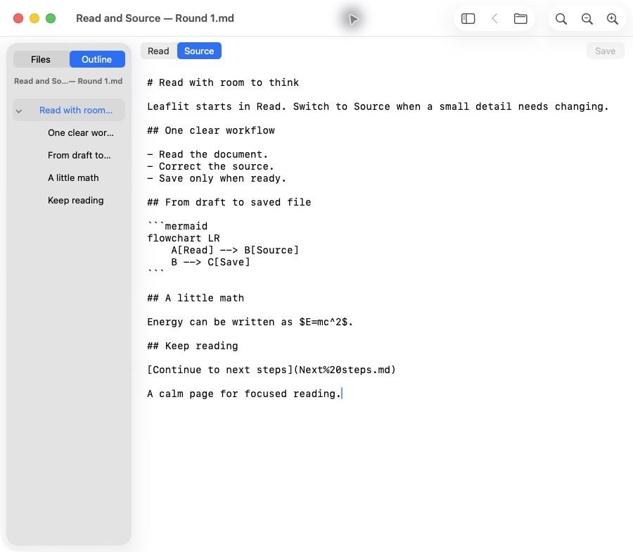

# Source editing in the local 0.3.0 candidate

Leaflit now starts in Read and offers a native Source editor for explicit corrections. The owner approved this scope after encountering malformed Markdown from terminal LLM workflows. Rich-text Write remains deferred. This report follows the [approved design](../design/source-editing/design.md) and [L3 test plan](../design/source-editing/test-plan.json). Public 0.2.0, the personal Homebrew tap, the website and the installed app remain unchanged.

## Candidate and automated verification

- Product source: `0e1bf1217c486997c9f2c8bec8427a001b7a9072`.
- Version 0.3.0, build 4; bundle ID `io.github.magicsih.leaflit`; arm64, macOS 14 deployment target.
- Ordinary app: `build/Leaflit-0.3.0/Leaflit.app`, with adjacent `leaflit` and `build-info.json`.
- Executable SHA-256: `7bf13064f9a786888a883efdcf8c3ae9dca3d061850b1f679a442db05d6123b5`.
- Actual host: Apple M3 (Mac15,13), macOS 26.6.2 (25G83), Xcode 27.0 (27A266a), Swift 6.4, Node 24.16.0 and npm 11.13.0. Earlier macOS execution was not verified.
- Independent `scripts/verify.sh Release` and separate ordinary `scripts/build.sh Release` both exited 0.
- Local ad-hoc signing only. No 0.3.0 Developer ID signing, notarization, installation, public release, Homebrew update or downloaded-artifact verification.

| Layer | Executed and passed |
| --- | ---: |
| Web | 14 |
| Standalone document module | 16 |
| Packaging | 7 |
| Xcode Release | 79: Reader 53, SourceFile 10 and the same core 16 |
| Ordinary Release build | Passed |

There are 116 test executions across these layers, representing 100 unique methods when the repeated core suite is counted once. The production dependency audit reported no vulnerabilities. Full regression includes the prior reader behavior, safe previews, Unicode and space paths, all math delimiters, Mermaid, file identity and exact bytes, failed saves, latest-result rejection, and 1MiB/5MiB Source edits with exact explicit saves. Native lifetime tests cover the editor and owned Undo manager after close; they do not classify persistent WebKit helper memory as a leak or cache.

Full logs, archived xcresults, verification lineage and the ordinary app manifest are retained locally under ignored `build/source-editing/full-0e1bf12/`. The entire reviewed app, launcher and build-info were also copied to `build/source-editing/candidate-0e1bf12-before-ui/` with byte, mode and symlink equivalence before UI execution.

## Behavior and fixes

Source is a lazily created plain NSTextView with native selection, Find, zoom and an owned Undo manager. Read previews the unsaved draft. Opening, rendering, refreshing and switching modes never write. Only Save or Save a Copy writes a document; there is no autosave or formatting. UTF-8 BOM, existing line endings and Unicode are retained.

The draft model compares exact UTF-8 bytes, rather than Swift's canonically equivalent String equality. The file adapter validates regular-file descriptors, identity and bytes inside a coordinated write, stages a private sibling file and replaces atomically while retaining destination metadata. It refuses missing originals, introduced symlinks and permission failures. Save a Copy creates a new file exclusively, including original-path alias and case checks. Coordination is not filesystem-wide compare-and-swap against an unrelated uncoordinated writer racing between comparison and replacement.

Dirty drafts survive watcher events, renderer readiness failures, appearance changes and late reads. Save failures cancel pending navigation, close or quit. Reload Cancel restores usable editing even if another watcher result arrived while the sheet was open. Discard synchronizes the draft, visible editor and Undo history.

Both formula and Mermaid errors offer Edit Source at the original block. Source line mapping follows the parser's CR/LF boundaries, including BOM, CRLF, repeated blocks and Unicode separators. Choosing an Outline heading in Source returns to Read with the target anchor in the same preview request, after final layout.

Executed native tests exposed a case where Undo changed the displayed text without synchronizing the draft. The controller now observes only its owned Undo manager's completed Undo/Redo notifications. Save and Source transitions break typing coalescing; presentation-only font changes do not become edit history. Identical-byte replacement of a clean file refreshes identity without dropping Undo. The final integration fixture uses explicit groups, so actual keyboard behavior was required separately in round 3.

## Three independent native UI rounds

All rounds used the same frozen ordinary product above, fresh owned processes and disposable reviewer files. UI input used CUA; fixtures were changed only for the planned explicit saves and external-file fault cases. Tests and code inspection were not substituted for actual input.

| Round | Observed result |
| --- | --- |
| 1 | Default Read, both error-to-Source routes, repairs, unsaved preview, exact Command-S, basic Undo/Redo, Read Find, ordinary body Copy, relative navigation and Back passed. Rendered formula plain-text clipboard fidelity did not pass. |
| 2 | Dirty link, Files and Back protection; close Save/Cancel/Discard; atomic replacement; Reload Cancel during another replacement; exact new-file copies; deletion without recreation; read-only Save failures; multiwindow Quit Cancel and final Save recovery passed within the observation limit below. |
| 3 | Individual keypress Undo across Save, Source/Read Find and match movement, Escape editing focus, Source Outline navigation, narrow-window and enlarged-view operation passed within the geometry and appearance limits below. |

Round 1 checked that the original 425-byte fixture remained unchanged through repair and unsaved preview. Only actual Command-S wrote the two intended corrections, producing the exact expected 445 bytes. A temporary copy/paste check was undone without saving.

Round 2 compared intended draft, external replacement, deleted original and new-copy bytes separately. After Q1 Discard then Q2 Quit Cancel, the continuing three-window inventory, unchanged Q1 original and next Quit asking only Q2 were observed. Q1's editor contents after discard were not directly observed because a CUA Window-menu item had no frame. Automated discard synchronization coverage remains separate.

Round 3 used individual digit keypresses: type 123, Command-S, type 456, Command-Z restored saved 123 and clean state; a second Undo removed 123 and marked dirty; Redo restored saved 123 and clean state. Disk bytes matched the expected explicit save. An initial letter probe used the existing non-Latin input method and was undone before saving; OS input settings were not changed.

The narrow capture was 480×784px. Actual Size followed by ten native Zoom In actions enlarged both modes while Find remained usable. CUA did not directly expose native point-valued window bounds or numeric zoom. Separate native tests assert a 28pt Source font after ten increments and native minimum-width/2.0 page-zoom geometry; those are not direct observations of this ordinary UI run.

Per-process `-AppleInterfaceStyle Dark` attempts left Source and Read visibly light. Ordinary 0.3.0 dark appearance remains unverified; [issue #27](https://github.com/magicsih/leaflit/issues/27) tracks the missing observation. No global appearance or accessibility setting was changed.

Transient AX failures at some Source transitions, one stale-state rejection and native chooser field commitment were recorded. A fresh uniquely owned target was confirmed before further input. These tool limits were not counted as app crashes. Local raw reports, action times, AX trees and original JPEG metadata remain under `build/source-editing/ui-round1-0e1bf12/`, `ui-round2-0e1bf12/` and `ui-round3-0e1bf12/`. Exactly three rounds were executed; no fourth round was started.



This is the original ordinary-app JPEG from round 1, with reviewer-owned English content. It was not reconstructed or relabeled as a signed distribution.

## Paired memory observations

The primary comparison uses six fresh processes with the fixed 102,400-byte `Fixtures/Benchmark100KiB.md`, SHA-256 `55464dacf92db737fbec845a17723c38da683d0fcef0b52d994a0040edff7f61`. Run order was Read, Source, Source, Read, Read, Source, forming three alternating pairs. Each run first visibly rendered its math and Mermaid in Read. Source therefore means Source after Read, with the hidden WKWebView and its assets already loaded.

Windows used fresh defaults, initial 100% zoom, hidden sidebar and no chosen folder. Actual captures were 900×784px; native point bounds were not exposed. Both cohorts used three explicit CUA AX/screenshot requests and the same intended mode-click/title-activation sequence. All final corrected captures showed active appearance and the expected mode. Large Read AX trees omitted body descendants, so math/diagram readiness was verified from the original JPEGs. Source clicks sometimes returned a transient AX error after delivering the action; the final observation confirmed Source without an extra click. API-internal AX work is not quantified.

The collector waited before the final observation. Snapshot completion was timestamped immediately, before evidence writes, image emission or model interpretation. A later explicit confirmation did not reset the idle clock. First footprint child creation had to fall 15.0–15.5s after observation completion; observed starts were 15.0037–15.0124s. Subsequent captures started at least 0.5s after the prior child completed; observed gaps were 0.5031–0.5111s. Request and post-Popen creation-bound timestamps are retained, rather than claiming a kernel execution signpost. Clock and stale-gate/ownership checks passed before collection.

Only exact newly owned app/helpers were included. Paths, start tokens and responsible PID were checked before and after each capture. No UI input or observation occurred during settling and capture. The pre-existing installed app was preserved and excluded.

Results in MiB are the median of three fresh-run medians, with the full fresh-run-median range in brackets. Each run has three technical captures; eighteen captures are not eighteen independent launches.

| Metric | Read | Source after Read |
| --- | ---: | ---: |
| Tool total footprint | 130.58 [130.25–132.00] | 145.03 [143.72–145.16] |
| App footprint | 37.59 [37.52–37.66] | 43.49 [43.02–43.59] |
| Owned helper footprint | 93.17 [92.99–94.66] | 101.81 [100.49–102.27] |
| RSS sum, separate metric | 282.16 [281.89–284.72] | 317.17 [316.42–317.23] |

Source-minus-Read total-footprint differences in the three pairs were +13.141, +14.906 and +13.031MiB. Separately summarized component medians need not sum to the tool-total median. RSS and footprint are different metrics. This is a small observed whole-state comparison; it does not isolate editor allocation or establish a general causal estimate. The 60MiB comparison target remains unmet. Do not pool these CUA-observed values with earlier no-CUA 0.2.1 measurements.

The first six-run attempt collected eighteen samples with correct ownership but missed the planned timing: it slept 15s after collector invocation, leaving actual first captures 19.1–35.5s after the last observation. Its final Source capture also appeared inactive. That entire cohort remains unchanged and descriptive only. A new gate-wait collector was self-checked and used for the bounded corrected six-run cohort above. No initial sample was reused or silently dropped, and no fourth UI review was performed.

[Normalized data](source-editing-0.3.0.json) retains all 36 samples in separate original/corrected cohorts, per-process-role footprint and RSS, timing, medians, ranges and pair differences without personal paths or PIDs. Executed harnesses, protocols, gates, proofs, raw footprint output and preservation records remain under `build/source-editing/memory-0e1bf12/` and `memory-0e1bf12-corrected/`. These are host-local profiling records, not a new clean-checkout automated UI tool; reproducible product verification commands are below.

## Failed checkpoints and corrections

The history below preserves incomplete and failed execution states. A compilation failure is not a behavioral test failure, and a cancelled or abnormal test is not a completed result.

| Candidate | Scope | Observed checkpoint |
| --- | --- | --- |
| `2266188` | Core test-first | Compilation failed on missing SourceDraft; behavioral tests unexecuted |
| `b3c2db0` | SourceDraft | 8 passed |
| `95ec49b` | Native test-first | Compilation failed on missing APIs; 9 unexecuted |
| `4a33f30` | Native checkpoint | Web 14 and build passed; native test compilation failed on CGFloat ambiguity; 13 unexecuted |
| `0dad67c` | Native checkpoint | 3 started; 2 completed failures; 1 cancelled; 13 unstarted. Stopped after file acquisition failures |
| `e156848` | Native checkpoint | Compilation failed on Darwin.stat namespace; 21 unexecuted |
| `7aa45a2` | Native checkpoint | 22 executed; 21 passed; Undo failed with 2 assertions |
| `2464df3` | Native checkpoint | Compilation failed on MainActor probe; 28 unexecuted |
| `45f3001` | Native checkpoint | 29 started; 27 completed passes; 1 Outline completed failure; 1 Undo incomplete after 3 failed assertions and allocator diagnostic. Xcode restarted remaining tests automatically |
| `1813249` | Targeted Undo and Outline | Outline passed; Undo had 3 failed assertions and abnormal incomplete exit |
| `ab383f1` | Targeted Undo and Outline | 3 completed; 2 passed; new Undo grouping fixture failed 4 assertions; no abnormal exit |
| `0e1bf12` | Targeted and full regression | 3 targeted passed, followed by full verification and ordinary Release build passed. Explicit test Undo groups are not real keyboard evidence |

The final full suite had no test retry or abnormal exit. The allocator diagnostics in earlier incomplete Undo runs were observed; their root cause was not independently classified. They are not erased by later passing runs.

## Preservation and remaining limits

Every executor checked the exact candidate and installed bundle, current user-app identity, earlier candidates, historical evidence and source. Owned processes exited; no helper received a signal. UI rounds 1 and 2 conditionally restored only known-owned chooser/sidebar keys and confirmed full preference bytes. UI round 3 and both memory cohorts left the full preference bytes unchanged, so no restoration was needed. The corrected profile also preserved the owner's then-dirty README/design/image work exactly.

The first corrected-profile preservation comparison falsely compared a JSON-serialized bytes value with Python bytes. Its failed record remains local. Comparing the two retained plist decodings and the raw bytes passed; no settings mutation or sample replacement occurred. Instrumentation failures and corrections are recorded separately from product results.

Rendered ordinary prose copied correctly in round 1, but the formula `$E=mc^2$` pasted as fragmented symbols and another expression representation. The exact pasted payload and steps are retained locally; the cause is not diagnosed. [Issue #26](https://github.com/magicsih/leaflit/issues/26) tracks plain-text formula clipboard fidelity without removing accessible math semantics.

Spoken VoiceOver, earlier supported macOS, cross-app Finder drop and true host network isolation retain their existing unverified issue boundaries. A forced native appearance integration test is not spoken navigation or ordinary dark-screen evidence. No new startup-latency, idle-CPU or large-document memory comparison is claimed.

The ordinary bundle has 187 regular files, 6,770,743 apparent bytes (6.457MiB) and occupies 7,076KiB according to this filesystem's `du -sk`. This is local app-bundle size, not runtime memory or a compressed signed release archive.

## Reproduce and final handoff

```sh
./scripts/verify.sh Release
./scripts/build.sh Release
open -n -a "$PWD/build/Leaflit-0.3.0/Leaflit.app" "$PWD/Fixtures/Welcome.md"
./build/Leaflit-0.3.0/leaflit Fixtures/Welcome.md
```

Verification replaces the global `build/verification.json`, and the ordinary build replaces its versioned DerivedData/output. Archive existing evidence and the local 0.3.0 candidate before repeating these commands.

[Normalized data](source-editing-0.3.0.json) preserves scope, failures, complete memory samples and summary values without machine-specific process IDs or personal paths. Raw logs, app bundles and local evidence remain ignored. Final merged-main verification, a separate ordinary build and whole-app/launcher equivalence to the reviewed product are separate required handoff states, recorded in [issue #25](https://github.com/magicsih/leaflit/issues/25). They must not be inferred solely from this pre-merge product report.
